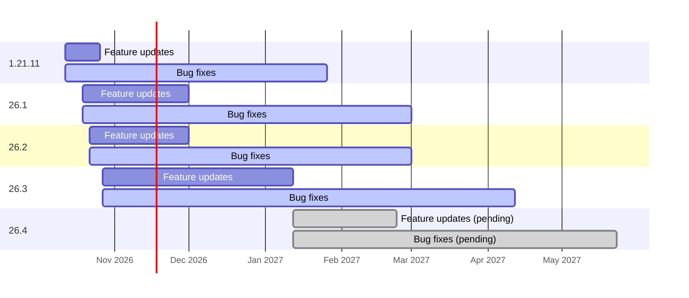

# CopperGolemMod

A Fabric mod that cuts the server tick cost of copper golems, especially in dense sorting farms, without changing how they sort.

- Minecraft `26.3` (any 26.3.x), Fabric Loader `0.20.1`+, Fabric API `0.165.0+26.3`+, Java 25
- Minecraft 26.2, 26.1 and 1.21.11 have their own `+26.2`, `+26.1` and `+1.21.11` releases, maintained on the `mc/26.2`, `mc/26.1` and `mc/1.21.11` branches. See [Supported versions](#supported-versions) for which versions get updates and for how long.
- Server-side logic only. Clients don't need it, and it also works in singleplayer.

## Install

1. Download `copper_golem_mod-<version>.jar` from the project's **Releases** page. Pick the release whose version ends in your Minecraft version (e.g. `0.2.0+26.1` is for Minecraft 26.1.x, `0.2.0+1.21.11` is for Minecraft 1.21.11).
2. Put it in your server's `mods` folder alongside [Fabric API](https://modrinth.com/mod/fabric-api), and remove any older CopperGolemMod jar.
3. Start the server. The defaults are safe; see [Config](#config) for options.

Each release also has a `.sha256` file for checking the download.

## Supported versions

Every Minecraft release from 1.21.11 on gets its own build, even if a newer one follows soon after. New features are built for the newest version first, then copied back to older versions that are still in feature updates.

- **Feature updates**: new features and optimizations, plus bug fixes.
- **Bug fixes**: bug and crash fixes for as long as the version is supported, which is until about 3 months after its feature updates end.
- **Unsupported** after that. Its releases stay available to download.

| Minecraft | Status | Releases | Branch |
| --- | --- | --- | --- |
| 26.4 | Pending: Minecraft 26.4 isn't released yet. Becomes the feature version once it's supported | | |
| 26.3.x | **Feature updates** until 26.4 is supported, then bug fixes | `+26.3` | `main` |
| 26.2.x | **Feature updates** until about 1 December 2026, then bug fixes | `+26.2` | `mc/26.2` |
| 26.1.x | **Feature updates** until about 1 December 2026, then bug fixes | `+26.1` | `mc/26.1` |
| 1.21.11 | **Bug fixes** until about 26 January 2027 (0.6.0 was its last feature release) | `+1.21.11` | `mc/1.21.11` |

The timeline below shows the same plan; the red line marks today. 26.4 is grey because Minecraft hasn't released it yet. Dates in the future are estimates, and the table above is what counts.



## Why golem farms lag

In a farm with hundreds of copper golems packed together, most of the cost is not the sorting itself. It's the golems noticing each other:

1. **Looking for players.** Every tick, each golem without a look target walks its whole list of nearby living entities (everything within 16 blocks) looking for a player within 6 blocks to stare at. With 1,800 golems packed together that's about 3.2 million checks per tick, and the answer is almost always "no player here". A crash report from a 1,800-golem test world showed the server thread stuck inside this scan (`SetEntityLookTargetSometimes` → `NearestVisibleLivingEntities.findClosest`) when the watchdog killed the server.
2. **Sorting the nearby-entity list.** Once a second each golem collects every living entity within 16 blocks and sorts it by distance. Vanilla recomputes two distances on every comparison.
3. **Asking whether a chest is in use.** Every tick, each golem close to its chest or waiting for it asks "is anyone using this chest?". Vanilla answers by listing every entity within 4 to 8.5 blocks of the chest (of both halves, for a double chest), when all the golem needs to know is whether there's at least one. For a double chest it also checks the other half for sitting cats first. In Spark profiles of an 864-golem farm this was about 5 ms per tick.
4. **Searching for the next chest.** When a golem looks for a chest, vanilla builds an inventory for every chest within 32 blocks, including a check for sitting cats on each half, and only then checks whether the chest is the right kind or one the golem has already tried. In the same profiles this was about 4 ms per tick.
5. **Physics and pushing.** Golems trapped in sorter cells still run full movement physics and push against each other every tick.

## What the mod does

### Vanilla-identical optimizations (on by default)

These give exactly the same result as vanilla; they just compute it more cheaply.

| Option | What it does |
| --- | --- |
| `optimizations.fastPlayerLookCheck` | Before the player-look scan, checks whether any player in the world is within 6 blocks. If none is, the scan can't find anything, so it's skipped. If a player is close, the normal vanilla scan runs. |
| `optimizations.fastNearbyEntitySort` | Computes each distance once and uses a stable sort, which gives the same list in the same order as vanilla. About 2× faster per sensor update. |
| `optimizations.fastChestInUseCheck` | Answers "is anyone using this chest?" with the same yes or no as vanilla, but stops at the first viewer it finds and only looks at entities that can be viewers (players and copper golems). For a double chest, the other half's cat check only runs if someone is using that half, which is the only case where vanilla's answer depends on it. Golems still wait while a chest is in use. |
| `optimizations.fastChestSearch` | When a golem searches for a chest, rules out chests of the wrong kind, chests it has already tried and locked chests before building their inventories. A double chest's other half is only checked if the golem has tried it. The golem picks the same chest as in vanilla, and a cat sitting on a chest still blocks it. |

### Idle throttle (on by default)

When a golem searches and finds nothing to move (or has visited 10 chests), vanilla puts it in a 140-tick "transport cooldown". During that cooldown it cannot pick up or deliver items; it just wanders and looks around.

While a golem is in that cooldown, `idleThrottle` runs its sensors only 1 tick in every `sensorTickInterval` (default 4). The cooldown timer is ticked by a brain task, not a sensor, so it still runs at normal speed and golems start sorting again on the same tick they would in vanilla. The only visible difference is that idle golems notice nearby players and mobs slightly later. Golems that were just hurt are never throttled.

### Stationary sorter (off by default, behavior-changing)

For sorters where golems are deliberately trapped and never need to walk. Once a golem has stayed in the same block for `minStationaryTicks`, is on the ground, and is barely moving:

- `skipTravelWhenStationary` skips movement physics on ticks where the golem isn't trying to move. If its AI wants to walk, physics runs as normal.
- `skipCrammingWhenStationary` skips entity pushing and cramming checks on ticks where the golem isn't trying to move.
- Full physics still runs every `fullPhysicsTickInterval` ticks (default 20), so pistons, water, broken floors, and pushes are still picked up.

This does change behavior. Stationary golems take much less cramming damage and don't get pushed apart by each other. It is fine for trapped-golem cells, but test it on a copy of your world first.

To turn it on in game, run `/cgp accept-consequences`, which explains what changes, then run it again within 60 seconds to confirm. After that, `/cgp config set stationarySorter.enabled true`. In the config file, it needs both flags:

```json
"stationarySorter": {
  "enabled": true,
  "iUnderstandThisChangesCopperGolemBehavior": true
}
```

### Behavior options (vanilla by default)

| Option | What it does |
| --- | --- |
| `behavior.golemsLookAtPlayers` | `true` (default) is vanilla: golems sometimes turn to look at a player within 6 blocks. `false` turns this off completely. It's purely cosmetic, so sorting is unaffected, and it also removes the remaining cost of golems looking for players when you stand inside a large farm. |

## Config

`config/copper_golem_mod.json` is created on first start. Missing options get their defaults, and the file is rewritten on every load so new options appear. If the file can't be parsed, the mod falls back to defaults and keeps the broken file as `copper_golem_mod.json.bad`.

Operators can also change every setting in game without editing the file: [`/cgp config`](#commands) opens a settings screen, and there are chat commands too. Changes apply at once and are saved to the file.

```json
{
  "enabled": true,
  "optimizations": {
    "fastPlayerLookCheck": true,
    "fastNearbyEntitySort": true,
    "fastChestInUseCheck": true,
    "fastChestSearch": true
  },
  "idleThrottle": {
    "enabled": true,
    "sensorTickInterval": 4
  },
  "behavior": {
    "golemsLookAtPlayers": true
  },
  "stationarySorter": {
    "enabled": false,
    "iUnderstandThisChangesCopperGolemBehavior": false,
    "minStationaryTicks": 40,
    "skipTravelWhenStationary": true,
    "skipCrammingWhenStationary": true,
    "fullPhysicsTickInterval": 20,
    "maxHorizontalVelocitySquared": 0.0025
  },
  "metrics": {
    "logIntervalSeconds": 0
  }
}
```

`enabled: false` turns every optimization off at runtime (`/cgp config set enabled false`, or edit the file and run `/cgp reload`) without removing the mod.

Upgrading from 0.1.x: the old `config/copper_golem_parallel.json` is no longer read and can be deleted.

## Commands

Operator only (permission level 2):

| Command | Effect |
| --- | --- |
| `/cgp status` | Current settings, golems ticked per server tick, stacks taken/placed per minute, and how often each optimization kicked in |
| `/cgp reset` | Reset the counters |
| `/cgp config` | Opens the settings screen: switches, sliders and text boxes for every setting, applied and saved when you press Save. Players don't need the mod for it. From the server console it lists the settings instead |
| `/cgp config list` | List every setting and its value. Changed settings are highlighted; hover a setting to see what it does, click it to fill in the command to change it |
| `/cgp config get <setting>` | One setting's value, default and allowed values |
| `/cgp config set <setting> <value>` | Change a setting. It applies at once, is saved to the config file, and is reported to other operators and the server log. Setting names and values tab-complete |
| `/cgp config reset <setting>` | Put a setting back to its default |
| `/cgp config apply <setting>=<value> ...` | Change several settings at once, all or nothing: if any value isn't allowed, nothing changes. This is what Save on the settings screen runs |
| `/cgp accept-consequences` | Accept that the [stationary sorter](#stationary-sorter-off-by-default-behavior-changing) changes golem behavior. Run it twice to confirm; it's needed before `stationarySorter.enabled` can be turned on |
| `/cgp reload` | Reload the config file after editing it (stops a running benchmark) |
| `/cgp profile on\|off` | Time every golem tick and report the average cost in `/cgp status` (adds a little overhead while on) |
| `/cgp bench ab [minutes] [phaseSeconds]` | A/B benchmark: switches the mod on and off and compares them (default 10 min, 30 s phases) |
| `/cgp bench current [minutes]` | Benchmark the current config as-is (default 5 min), e.g. to compare versions or other mods |
| `/cgp bench status` / `stop` | Show progress / stop early and report what was measured |

Settings use their path in the config file, e.g. `idleThrottle.sensorTickInterval`. They can't be changed while a benchmark is running, so the results always measure one config.

## Benchmarking

```text
/cgp bench ab
```

This runs for about 10 minutes of game time while the farm keeps working as usual. It switches the mod on and off every 30 seconds, in the order on, off, off, on, on, off, …, so changes in the world during the run (villager schedules, item input, mob counts) affect both sides equally. Only the in-memory setting is switched; the config file is never changed. The first 5 seconds of every phase are a warm-up and aren't measured.

At the end it reports, for the mod on and off:

- **MSPT** (mean and p95), measured by the mod itself
- **TPS**
- **golem time per tick** and **cost per golem tick**
- **stacks placed per 1,000 game ticks**: sorting speed per game tick, so it doesn't depend on TPS
- **phase spread**: how much results vary between phases, to tell a real difference from noise

It also gives a verdict and warns if the mod made ticks slower or sorting slower, which would mean an optimization broke on that version. Feed the farm items during the run so sorting speed can be compared.

Results are also saved as JSON in `copper_golem_mod/benchmarks/` in the server folder, with the mod and Minecraft versions, other installed mods and the config, so runs on different versions can be compared side by side. See [TESTING.md](TESTING.md) for the full procedure.

### Example: 864 golems, ~390 villagers, simulation distance 32 (Minecraft 1.21.11, 5-minute Spark profiles)

| | MSPT mean | TPS |
| --- | --- | --- |
| Mod off | 62.6 ms | 16.0 |
| Mod on | 46.0 ms | 20.0 |
| Mod on + Lithium | 36.4 ms | 20.0 |

Every commit is also checked automatically. In-game tests confirm golems still behave like vanilla, and a benchmark runs on a copy of a real 865-golem farm, mod on vs off. See [TESTING.md](TESTING.md#automated-tests-every-commit).

## Compatibility

- **Lithium**: compatible and recommended. Tested with Lithium 0.21.4 on Minecraft 1.21.11: no mixin conflicts, every optimization stays active, and the improvements add up.
  Not yet tested with Lithium on Minecraft 26.x; use `/cgp bench current` with and without it to check.

## Versioning

Versions are `<mod version>+<Minecraft version>`, for example `0.2.0+26.1`. The mod version follows [Semantic Versioning](https://semver.org/); the part after `+` is the Minecraft version the jar was built for. See [CHANGELOG.md](CHANGELOG.md) for what changed in each release.

## Build from source

Gradle runs on any installed JDK 17+ and downloads the JDK 25 that Minecraft 26.x needs automatically.

```bash
./gradlew build
```

The jar is written to `build/libs/copper_golem_mod-<version>.jar`. See [CONTRIBUTING.md](CONTRIBUTING.md) for the development workflow, branches and the release process.

## History

0.1.x tried to parallelize golem ticking with worker threads, snapshots, and lock managers. None of it could do real work off the main thread, because Minecraft's world, entity, and brain objects aren't thread-safe. It only added overhead: every tick it copied each golem's target chest contents, queued jobs, and validated no-op decisions. The unsafe mode could also stall the main thread on lock timeouts. 0.2.0 removes all of that and targets the code that actually costs time.
